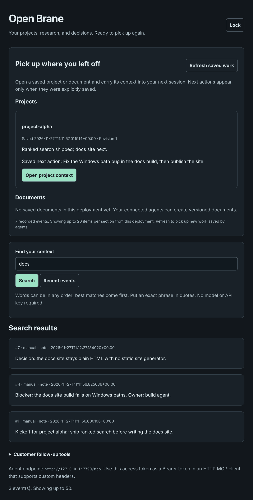

# Open Brane

**Self-hosted memory and task handoff for AI agents: one SQLite file, any MCP client, no API key.**

[](LICENSE)
[](https://www.python.org/downloads/)
[](https://modelcontextprotocol.io)
[](https://github.com/cgallic/open-brane/actions/workflows/test.yml)

- **Agents forget everything between sessions.** Open Brane saves notes, decisions, project checkpoints, and a saved next action, so the next session (or the next agent) resumes from what was written down.
- **Context is scattered across tools.** Claude Code, Cursor, Codex, and your own scripts read and write the same store through MCP, and you can browse it in a local web page.
- **Vector-database memory stacks need a model, an embedding key, and a second service.** Open Brane is one SQLite file with ranked full-text search (FTS5) built in. Semantic search is optional.

<p align="center"></p>

## Try it in 60 seconds

You need Python 3.11+ and Git. No model, API key, Ollama, or Qdrant.

```bash
git clone https://github.com/cgallic/open-brane.git
cd open-brane
python3 brane.py setup      # creates .venv, installs core deps, writes a private token, creates the database
python3 brane.py serve      # http://127.0.0.1:7778
```

Open **http://127.0.0.1:7778**, paste the token from `data/http-token`, save a note, and search for it. Running setup again keeps your configuration, token, and events. On Windows, use `py -3.11` in place of `python3`; no environment activation is needed.

From the terminal:

```bash
python3 brane.py doctor
python3 brane.py search pricing decision
```

Words can appear in any order and the best match comes first. Put an exact phrase in quotes.

### Docker

Only Docker with Compose is required:

```bash
git clone https://github.com/cgallic/open-brane.git
cd open-brane
docker compose -f compose.json up --build -d --wait
docker compose -f compose.json exec brane cat /data/http-token
```

Open **http://127.0.0.1:7778** and paste that token. The container runs as a non-root user, a named volume keeps your database, credentials, checkpoints, and artifacts, and only localhost is published by default.

## Connect Claude Code, Cursor, or Codex

Open Brane speaks MCP two ways. Both expose the same tools and the same database.

**Local stdio.** Print a ready-to-paste config with absolute paths:

```bash
python3 brane.py mcp-config
```

It prints this shape (your paths will differ):

```json
{
  "mcpServers": {
    "open-brane": {
      "command": "/path/to/open-brane/.venv/bin/python",
      "args": ["/path/to/open-brane/scripts/starter.py", "run", "--config", "/path/to/open-brane/data/starter.json"]
    }
  }
}
```

- **Cursor:** paste that `mcpServers` block into `~/.cursor/mcp.json` (all projects) or `.cursor/mcp.json` (one project).
- **Claude Code:** pass the same command after `--`:

  ```bash
  claude mcp add open-brane -- /path/to/open-brane/.venv/bin/python \
    /path/to/open-brane/scripts/starter.py run --config /path/to/open-brane/data/starter.json
  ```

- **Codex:** add the same command and args to `~/.codex/config.toml`:

  ```toml
  [mcp_servers.open-brane]
  command = "/path/to/open-brane/.venv/bin/python"
  args = ["/path/to/open-brane/scripts/starter.py", "run", "--config", "/path/to/open-brane/data/starter.json"]
  ```

**HTTP.** With `brane.py serve` running, the MCP endpoint is `http://127.0.0.1:7778/mcp` (Streamable HTTP, not the older SSE transport). Send `Authorization: Bearer <token from data/http-token>`.

```bash
claude mcp add --transport http open-brane http://127.0.0.1:7778/mcp \
  --header "Authorization: Bearer $(cat data/http-token)"
```

For a client that takes JSON, use a `url` plus a `headers` object with the same `Authorization` value. The HTTP token grants full owner access. It is not an OAuth login, and separate trust boundaries need separate deployments. See [Self-hosting](docs/SELF-HOSTING.md) for a VPS, HTTPS, backups, upgrades, token rotation, and troubleshooting.

## Pick up where you left off

The browser home screen lists saved projects (with the next action, when one was explicitly saved), saved documents with their revisions, quick note capture, ranked search, and recent events. **Copy context** copies a project into another session.

Agents use the same workspace:

- `workspace_overview`, `read_saved_project`, `read_saved_document` to find saved work.
- `save_work_session` to store what changed, decisions, blockers, sources, and a next action. Saves carry an `expected_revision`, so a stale save from an overlapping session is rejected instead of overwriting newer work.
- `resume_work_session` to bring that context back, with warnings when a referenced document has a newer version.
- `search_events` for ranked full-text search. Each result has a short `snippet` and says whether every word matched, so an agent can skim twenty results without reading twenty payloads.

Checkpoints and documents keep revision history and can be restored as a new revision. See [Your workspace](docs/WORKSPACE.md) for the full workflow and its limits.

## Hand work between agents by role

Post a task for a role, and whichever agent works that role claims it with the context it needs to start.

- `post_task`: post a task for a role such as `research` or `build`, with a brief, a `done_when` line, an optional `project_id`, and optional `depends_on` task ids.
- `claim_task`: an agent claims the next open task for its role. It gets the brief plus a briefing: the role's recent settled outcomes, the results of the tasks this one depends on, and the linked project's saved next action. Claims expire after a lease, so a crashed agent does not block the work.
- `settle_task`: `done` needs at least one proof item, such as a URL, commit, or event id. `blocked` and `failed` need a reason.
- `list_tasks` reads the board, and `role_brief` shows a role's queue, active claims, and recent results.

Example: a planner posts `research: compare three hosting options, done_when: a table with prices and links`, then posts a `build` task that `depends_on` it. A research agent claims the first task, settles it as done with the URL of its notes, and the build agent's claim now includes that outcome. `python3 brane.py tasks` prints the board from the terminal.

Run `python3 brane.py demo roles` to watch three scripted clients do this with temporary data. Every post, claim, and settlement is an append-only event, so the board can be rebuilt from the log and searched like any other note. The browser shows the same board read-only. See [docs/ROLES.md](docs/ROLES.md).

## How it compares

| | Open Brane | Hosted vector memory services | Markdown notes / `CLAUDE.md` files |
|---|---|---|---|
| Needs an API key or model | No (semantic search optional) | Usually, for embeddings and extraction | No |
| Storage | One SQLite file you own | The provider's database, or a vector DB you run | Files in your repo |
| Multi-agent handoff | Role task board with claims, leases, and proof | Shared memory, task handoff varies | Manual, by editing files |
| Audit trail | Append-only event log, revision history | Varies by service | Git history, if committed |
| Self-hosted | Yes, local or Docker | Some offer a self-hosted edition | Yes |
| Search | Ranked full-text (FTS5), optional vectors | Semantic similarity | grep, or the agent reads the files |

Vector memory is a better fit when you need fuzzy recall across wording that never overlaps. Plain files are a better fit for a few static instructions. The fuller comparison is in [docs/COMPARISON.md](docs/COMPARISON.md).

## Optional: customer follow-up tools

The browser includes a collapsed **Customer follow-up tools** section for contact facts, interaction history, and follow-up checks, with a matching [authenticated customer API](docs/CUSTOMER-HANDOFF.md). These are optional and the general workspace works without them.

`python3 brane.py demo` runs two scripted MCP clients against temporary synthetic data. They share a call summary, check recent outreach and stale contact facts, and reject a stale document edit. The clients are scripts, not autonomous agents, and the demo sends nothing.

## How it works

Every source you care about is normalized into **one append-only SQLite table called `events`**. That table is the source of truth. Obsidian pages, dashboards, the search index, semantic search, and agent context packets are views that can be rebuilt from it. There is one write path (`record_event.py`), and corrections append new events. Append-only is an application convention, so keep backups of the database and external attachments.

Agents use the [MCP](https://modelcontextprotocol.io) server to write and retrieve events, report which recalled items they used, propose reasoning edges, save checkpoints and documents, hand off tasks, and optionally work with contacts, deals, and outreach history. See [ARCHITECTURE.md](ARCHITECTURE.md) for data flow and schema, and the [starter guide](docs/STARTER.md) for configuration and provider contracts. Existing `starter.py` commands remain supported.

### The three problems it is built for

**1. Context that doesn't drift between agents.**
Agents write events and read events. The markdown, Google Doc, Notion page, or Obsidian vault is a rendered view that can be rebuilt. If two agents disagree, you diff events.

**2. Definitions that don't fight each other.**
Store raw source data and compute derived metrics on read. Stripe's MRR calculation and yours will differ, and that is fine, because the events stay raw. A definition-layer query joins over them when someone asks, so no stored derived number drifts from its source.

**3. Pipelines that break silently.**
Adapters should use stable source identities and deduplicate retries. The canonical writer supports `--dedupe-key`; legacy writes without a key append again. The git and Claude session adapters pass one, so a scheduled re-run returns the existing events instead of appending copies. The vector embedder skips already indexed event IDs. `health_check.py --record` writes its own probe as an event, so you can query uptime history from the same table.

## Design principles

- **Append-only.** No UPDATEs. No DELETEs. Corrections reference prior event IDs.
- **One write path.** Everything writes through `record_event.py`.
- **Scripts are pure functions.** Read, compute, write, exit. No state machines, no background workers.
- **Cron is the orchestrator.** If a script fails, the next tick retries. No queues, no DLQs.
- **Owner-controlled access.** Use local stdio by default. The included HTTP server requires an owner Bearer token; business filters are not multi-user authentication.
- **Views are rebuildable.** Obsidian pages, wiki pages, the text-search index, and the vector DB are all derived. Delete and rebuild anytime.

## Stack

| Component | Why |
|---|---|
| SQLite (WAL) | A portable event store. Back up and verify your database like any other persistent data. |
| SQLite FTS5 | Ranked full-text search. The index is rebuildable from `events` (`python3 brane.py reindex`). |
| MCP (Model Context Protocol) | Agent-to-tool interface spoken by Claude Code, Cursor, Codex, and custom agents. stdio and Streamable HTTP. |
| Python 3.11+ | The standard library does most of the work. |
| Ollama + nomic-embed-text | Optional semantic search. The model and dimensions are configurable. |
| Qdrant | Optional vector index. The included scripts use the Qdrant API; another vector engine requires an adapter. |

## Optional sidecar schemas

The core is one `events` table. That's the contract. Once agents are *writing* events (not just adapters), three more schemas are worth applying:

| Schema | What it adds | Doc |
|---|---|---|
| `schemas/governance.sql` | Per-event provenance + review state + use-policy. Enforces "agents cannot self-promote their own writes to instruction-grade" via a SQL CHECK constraint. | `docs/GOVERNANCE.md` |
| `schemas/recall_traces.sql` | Every retrieval writes a trace; the agent reports back which items it used. Surfaces dead-weight events and bad queries. | `docs/RECALL-TRACE.md` |
| `schemas/edges.sql` | Typed reasoning edges (supports / contradicts / supersedes / depends_on) with weight, decay, and temporal validity. Powers a `questioned_decisions` view: "active decisions that have surfaced contradictions". | `docs/EDGES.md` |

All three are additive and idempotent. The starter applies them in dependency order; manual installations can apply them one at a time. `scripts/policy_check.py` checks known secret patterns, oversized payloads, and code blobs before writes. It is not a complete sensitive-data scanner.

## Extending

**To add a source** (ClickUp, Stripe, Fathom, Slack, anything): copy `scripts/ingest_gdrive.py`, rewrite the fetch loop, pick a stable dedup fingerprint for the `actor` field, add a cron line. See `docs/ADAPTERS.md`.

**To add a view** (dashboard, PDF export, Slack digest): query `events.db`, format, write. No brain-side changes needed.

**To add an MCP tool**: edit `scripts/mcp_server.py`, add a `@mcp.tool()` function, restart the service.

**To add a daily reflection layer**: see `docs/PATTERN-SCANNER.md` for a four-stage loop (scan, rate, research, promote) that surfaces cross-project tensions, lets you rate them with one click, and suppresses noise. It is a reference design, not yet ported as standalone scripts.

<details>
<summary><strong>Repository layout</strong></summary>

```
open-brane/
├── README.md                  ← this file
├── ARCHITECTURE.md            ← data flow, schema, failure patterns
├── SCHEMA.sql                 ← the one table that runs the whole system
├── LICENSE                    ← MIT
├── brane.py                   ← setup / serve / doctor / search / tasks / mcp-config / demo
├── requirements.txt
├── scripts/
│   ├── record_event.py        ← the only write path
│   ├── starter.py             ← validate / initialize / diagnose / run / embed
│   ├── runtime_config.py      ← deployment JSON → existing environment API
│   ├── tasks.py               ← role task board (post / claim / settle)
│   ├── crm.py                 ← event-backed contacts, deals, outreach checks
│   ├── crm_providers.py       ← optional read-only external contact facts
│   ├── query_events.py        ← filtered reader
│   ├── search_index.py        ← ranked full-text search (SQLite FTS5, rebuildable)
│   ├── embed_events.py        ← events → Qdrant (incremental, idempotent)
│   ├── semantic_search.py     ← vector search + payload join
│   ├── health_check.py        ← probe Ollama + Qdrant + events.db
│   ├── policy_check.py        ← unsafe-write filter (secrets, size, code blobs)
│   ├── ingest_gdrive.py       ← Drive extract → events (canonical adapter)
│   ├── ingest_claude.py       ← Claude Code sessions → events
│   ├── ingest_git.py          ← git log / gh api → events
│   ├── gdrive_extractor.py    ← runs on the machine with Drive mounted
│   └── mcp_server.py          ← MCP server
├── schemas/                   ← optional sidecar schemas, apply one at a time
│   ├── governance.sql         ← provenance / review / use-policy invariant
│   ├── recall_traces.sql      ← log every retrieval + which items the agent used
│   └── edges.sql              ← typed reasoning edges with temporal validity
├── config/
│   ├── starter.example.json   ← copy and replace your deployment settings
│   ├── starter.schema.json    ← configuration shape
│   ├── gdrive-sources.json.example
│   ├── git-repos.json.example
│   └── web-sources.json.example
├── systemd/
│   └── brain-mcp.service      ← template (swap BRAIN_ROOT + bind host)
└── docs/
    ├── WORKSPACE.md           ← save, resume, and continue saved work
    ├── ROLES.md               ← role task board for agent handoffs
    ├── SELF-HOSTING.md        ← VPS, HTTPS, backups, upgrades, token rotation
    ├── COMPARISON.md          ← Open Brane vs. vector memory vs. markdown files
    ├── STARTER.md             ← portable setup, MCP tools, CRM provider ABI
    ├── ADAPTERS.md            ← how to write a new ingest adapter
    ├── STRUCTURED-OUTPUTS.md  ← the skill-output-contract pattern
    ├── CONDUCTOR-FLOW.md      ← long-running multi-agent orchestration
    ├── GOVERNANCE.md          ← agent-memory trust layer (apply with governance.sql)
    ├── RECALL-TRACE.md        ← closing the retrieval feedback loop
    └── EDGES.md               ← typed reasoning edges, supports/contradicts/etc.
```

</details>

## License

MIT. See `LICENSE`.

## Credits

Built as the persistent-memory layer for a personal agent mesh.

If Open Brane saves you from re-explaining a project to an agent, a star helps other people find it.

## Related links

- [MeetKai](https://meetkai.xyz) — the operator layer behind Kai CMO workflows.
- [KaiCalls](https://kaicalls.com) — AI voice agents for small-business phone answering and lead capture.
- [Connor Gallic](https://connorgallic.com) — founder building Kai, KaiCalls, and AI automation systems.


---

*Built and maintained by [Connor Gallic](https://pr.linkedin.com/in/cgallic) — connect on LinkedIn.*
